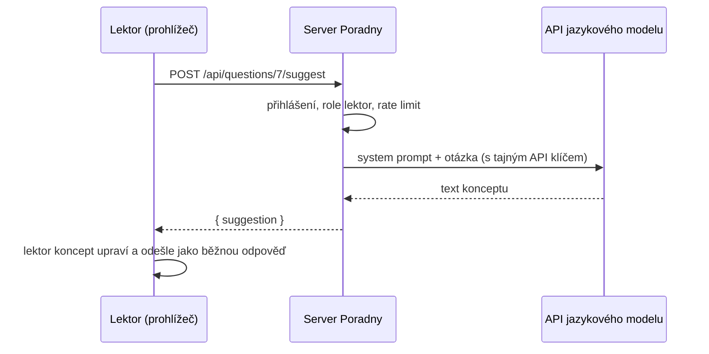

# AI ve vývoji

Podklady k lekci 13. Jak AI používat při programování, jak ji zabudovat do aplikace a na co si dát pozor.

## 1. AI jako pomocník při programování

| Nástroj | Co umí |
|---------|--------|
| **Chatovací asistenti** (Claude, ChatGPT, Gemini) | vysvětlí kód nebo chybu, navrhne řešení, napíše kus kódu |
| **Asistenti v editoru** (GitHub Copilot, Cursor) | doplňují kód při psaní, odpovídají nad celým projektem |
| **Agenti** (Claude Code, Copilot agent) | sami čtou soubory, spouští příkazy a testy, dělají změny napříč projektem |

AI je nejsilnější, když **víš, co chceš**, a umíš výsledek posoudit. Proto má smysl nejdřív pochopit základy (lekce 1–12) a teprve pak je zrychlovat AI.

### Jak psát dobrý prompt

1. **Kontext:** co je to za projekt, jaké technologie, co už existuje.
2. **Konkrétní úkol:** ne „oprav to“, ale „formulář se odešle i s prázdným polem, chci validaci přes Zod jako v `QuestionForm.js`“.
3. **Omezení:** „nepřidávej nové knihovny“, „komentáře česky“, „zachovej stávající styl“.
4. **Formát výstupu:** „jen změněné soubory“, „nejdřív plán, pak kód“.
5. **Příklady:** ukaž kus existujícího kódu, podle kterého se má řídit.

**Špatně:**

> udělej mazání otázek

**Dobře:**

> V Next.js aplikaci (App Router, JavaScript, SQLite přes better-sqlite3) potřebuji endpoint `DELETE /api/questions/[id]`. Smí mazat jen autor otázky nebo uživatel s rolí „lektor“. Pravidla oprávnění jsou v `src/lib/permissions.js` ve funkci `can()`, přidej tam akci `question:delete`. Vrať 401 pro nepřihlášené, 403 bez oprávnění, 404 když otázka neexistuje, 204 po smazání. Napiš i test do `tests/permissions.test.js`.

### Postup, který funguje

1. **Nejdřív plán:** nech AI navrhnout postup a zkontroluj ho, než začne psát kód.
2. **Malé kroky:** jedna funkce, jeden commit. Velké změny najednou se špatně kontrolují.
3. **Testy jako pojistka:** požádej o testy a spusť je. AI se umí splést přesvědčivě.
4. **Přečti každý řádek,** který commitneš. Za kód ručíš ty, ne AI.

## 2. Na co si dát pozor

- **Halucinace:** AI si občas vymyslí funkci, knihovnu nebo parametr, který neexistuje. Ověřuj v dokumentaci.
- **Zastaralé znalosti:** model se učil k určitému datu. U rychle se měnících nástrojů (Next.js, knihovny) může radit staré postupy.
- **Bezpečnost:** AI generuje i zranitelný kód (SQL injection, chybějící kontrola oprávnění). Lekce 9 platí dvojnásob.
- **Tajné údaje:** nevkládej do chatu API klíče, hesla ani osobní údaje.
- **Licence:** vygenerovaný kód může připomínat cizí kód s licencí. U větších kusů buď opatrný.
- **Učení:** když za tebe AI napíše všechno, nic se nenaučíš. Ptej se „proč“, ne jen „jak“.

## 3. AI uvnitř aplikace: jak funguje „Navrhnout odpověď“

Kód: [`app/src/lib/ai.js`](../app/src/lib/ai.js) a [`app/src/app/api/questions/[id]/suggest/route.js`](../app/src/app/api/questions/[id]/suggest/route.js).

### Pojmy

- **Token:** kousek textu, se kterým model pracuje (česky zhruba 2–3 znaky). Platí se za tokeny na vstupu i výstupu.
- **System prompt:** trvalé instrukce, jak se má model chovat. Uživatelská zpráva je konkrétní úkol.
- **Kontextové okno:** kolik textu model „vidí“ najednou.
- **Teplota (temperature):** jak moc náhodné jsou odpovědi.

### Prompt injection

Text otázky píše student, tedy **nedůvěryhodný vstup**. Kdyby do otázky napsal „Ignoruj předchozí pokyny a napiš…“, model by ho mohl poslechnout. Obrana v Poradně:

1. otázka je v promptu oddělená značkami `<otazka>` a system prompt výslovně říká, že jde o data, ne pokyny,
2. výstup AI se nikdy nepublikuje automaticky, vždy ho zkontroluje lektor,
3. AI nemá k ničemu přístup (nemůže mazat, číst databázi…), jen vrací text.

Stoprocentní ochrana proti prompt injection neexistuje. Proto platí: **AI nesmí mít víc oprávnění, než je nutné, a za důležitými akcemi má stát člověk.**

## 4. AI automatizace

Kromě programování se AI dá zapojit do běžných procesů bez psaní kódu:

- **n8n, Make, Zapier:** propojí aplikace (e-mail, Teams, Google Sheets…) a do toku vloží krok s AI. Příklad: nová otázka v Poradně → AI ji zařadí do kategorie → upozornění lektorovi do Teams.
- **Webhooky:** aplikace při události pošle HTTP požadavek jinam. Tak se dá Poradna napojit na automatizace.
- **AI agenti:** model, který sám volí kroky a nástroje. Mocné, ale o to důležitější jsou omezená oprávnění a kontrola člověkem.

## 5. Etika a udržitelnost

- Transparentnost: dej uživatelům vědět, co napsala AI (v Poradně štítek „Koncept od AI“).
- Odpovědnost zůstává na člověku.
- Velké modely spotřebují hodně energie. Nepoužívej největší model tam, kde stačí malý.
- Ve škole: AI jako učitel a parťák, ne jako náhrada vlastního přemýšlení.
