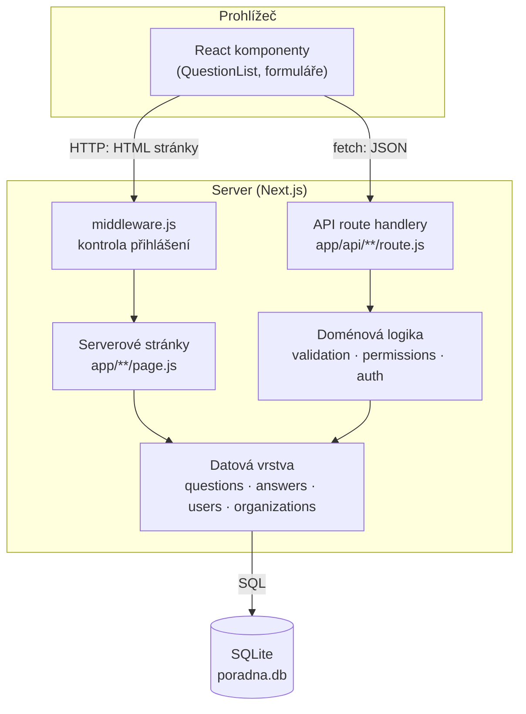
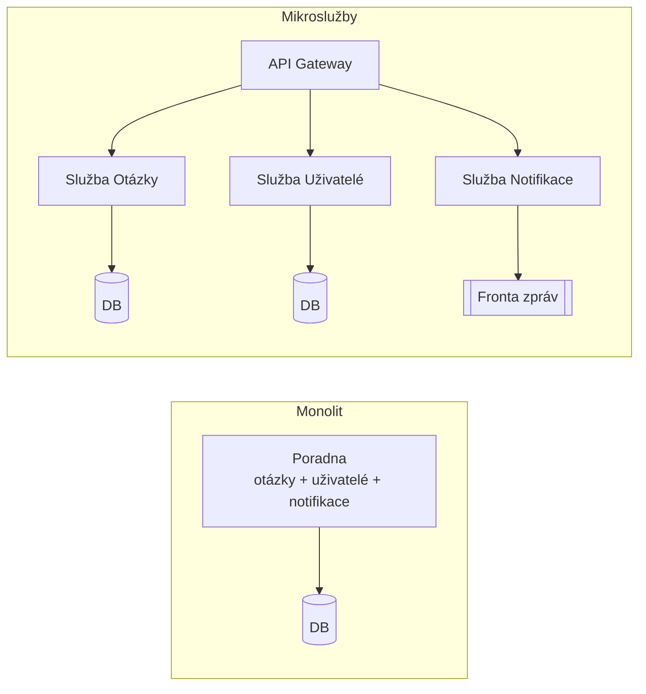
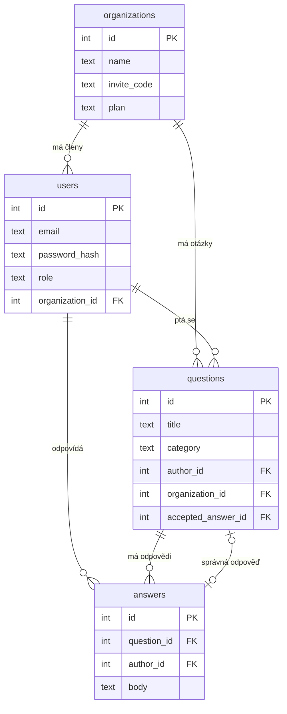

# Architektura Poradny

Jak je aplikace poskládaná a proč. K lekci 11 (SaaS a architektura), ale hodí se kdykoli, když se v projektu ztratíš.

## Vrstvy aplikace

Pravidlo: každá vrstva mluví jen s vrstvou pod sebou. Stránky a API nepíšou SQL, to dělá jen datová vrstva. Díky tomu šlo v lekci 4 vyměnit pole v paměti za databázi a zbytek kódu se skoro nezměnil.

## Monolit vs. mikroslužby

Poradna je **monolit**: jedna aplikace, jedno nasazení, jedna databáze. Pro malý tým a malý projekt je to správná volba.

| | Monolit | Mikroslužby |
|---|---|---|
| Začátek projektu | rychlý a jednoduchý | pomalý, hodně infrastruktury |
| Nasazení | vše najednou | každá služba zvlášť |
| Škálování | celá aplikace | jen přetížená služba |
| Tým | ideální do ~10 lidí | víc týmů, každý vlastní službu |
| Chyby | jedna chyba může shodit vše | výpadek jedné služby nemusí vadit ostatním |
| Složitost | v kódu | v síti (komunikace, latence, konzistence dat) |

Rozumný postup je začít monolitem s čistě oddělenými vrstvami a na mikroslužby přejít, až to bude opravdu potřeba. Kandidát na první samostatnou službu by v Poradně byly e-mailové notifikace: běží na pozadí a nesouvisí s hlavním během aplikace.

## Multi-tenancy (více zákazníků v jedné aplikaci)

Od lekce 11 v Poradně může mít vlastní prostor víc škol. Existují tři hlavní modely:

| Model | Jak | Výhody | Nevýhody |
|---|---|---|---|
| **Sdílené tabulky** *(Poradna)* | jedna DB, sloupec `organization_id` v tabulkách | nejjednodušší, levné | chyba ve `WHERE` = únik dat k jiné škole |
| Schéma na zákazníka | jedna DB, každý tenant má vlastní sadu tabulek | lepší oddělení | složitější migrace |
| Databáze na zákazníka | každý tenant vlastní DB | nejlepší izolace, snadné smazání zákazníka | drahé, náročné na správu |

Jak se v Poradně bráníme úniku dat:

1. `organization_id` se bere **vždy z přihlášeného uživatele**, nikdy z požadavku.
2. Filtr je v **datové vrstvě** (`getQuestion(id, organizationId)`), takže na něj stránka nemůže zapomenout.
3. Otázka cizí školy vrací **404**, ne 403, a neprozradí tak, že existuje.
4. Izolaci hlídá **test** `tests/questions.test.js → oddělení organizací`.

## Datový model

## API

Popis všech endpointů ve formátu OpenAPI je v [`docs/api/openapi.yaml`](api/openapi.yaml). Hezky si ho zobrazíš, když obsah souboru vložíš do [editor.swagger.io](https://editor.swagger.io).
